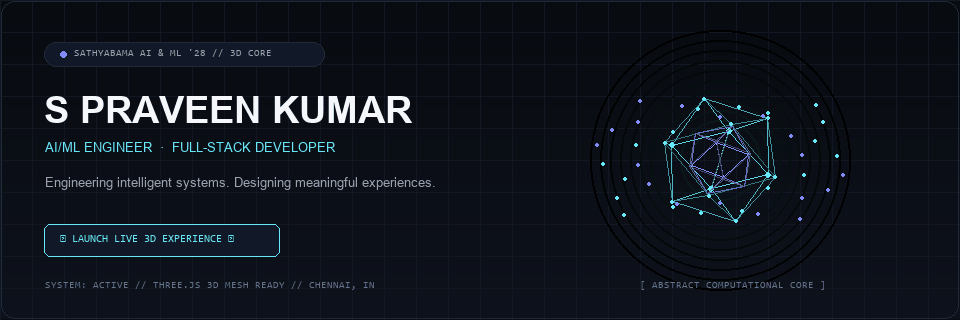
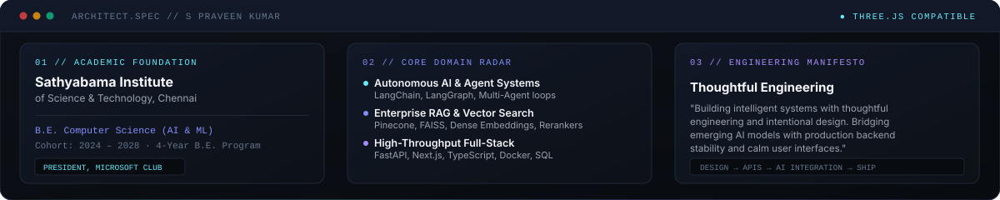
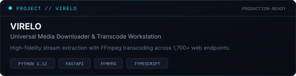
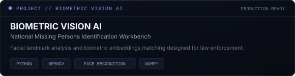
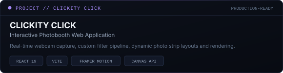
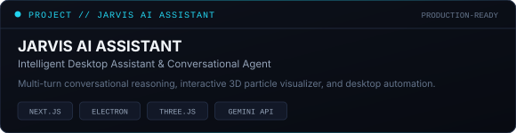
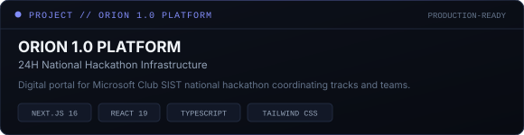
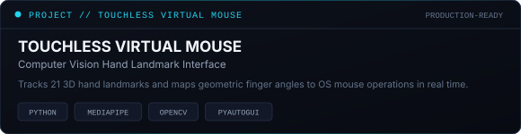
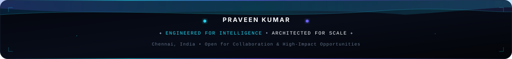

<!-- ================================================================= -->
<!-- CINEMATIC 3D HERO — COMPUTATIONAL IDENTITY                        -->
<!-- ================================================================= -->

  <a href="https://praveeneyyy.vercel.app/experience" target="_blank" rel="noopener noreferrer">
    <picture>
      <source media="(prefers-color-scheme: dark)" srcset="assets/hero-preview.gif">
      <source media="(prefers-color-scheme: light)" srcset="assets/hero-static.png">
      
    </picture>
  </a>

<!-- 3D LIVE LAUNCH PILL & TYPING SVG -->

  

  

  <i>"Engineering intelligent systems. Designing meaningful experiences."</i>

<!-- MINIMAL SOCIAL & QUICK-CONNECT BAR -->

  &nbsp;
  &nbsp;
  &nbsp;
  

<!-- TELEMETRY BADGES -->

  &nbsp;
  &nbsp;
  &nbsp;
  

<!-- SECTION DIVIDER -->

  

<!-- ================================================================= -->
<!-- SECTION 01: ABOUT ME                                              -->
<!-- ================================================================= -->

<h2 align="center">✦ 01 // ARCHITECT &amp; DEVELOPER IDENTITY</h2>

  

I am a <b>Computer Science and Engineering (AI &amp; ML) scholar</b> at <b>Sathyabama Institute of Science and Technology, Chennai (2024–2028)</b>, dedicated to building intelligent, autonomous software, exploring emerging AI technologies, and engineering products that solve practical problems with production stability.

My engineering perspective spans the <b>entire development lifecycle</b>:

<ul>
  <li><b>Design &amp; Frontend:</b> Crafting intentional, accessible, and responsive user experiences using <code>Next.js</code>, <code>React 19</code>, <code>TypeScript</code>, and <code>Tailwind CSS</code>.</li>
  <li><b>High-Throughput Backends:</b> Architecting asynchronous REST microservices and APIs with <code>Python 3.12</code>, <code>FastAPI</code>, <code>Node.js</code>, and <code>Spring Boot</code>.</li>
  <li><b>AI &amp; Agent Systems:</b> Designing autonomous agent reasoning loops with <code>LangGraph</code>, context-grounded RAG pipelines with <code>Pinecone</code> and <code>FAISS</code>, and computer vision algorithms with <code>OpenCV</code> and <code>MediaPipe</code>.</li>
  <li><b>Community Leadership:</b> Serving as <b>President of Microsoft Club, Sathyabama</b>, fostering developer culture, organizing national hackathons, and mentoring junior engineers.</li>
</ul>

<!-- SECTION DIVIDER -->

  

<!-- ================================================================= -->
<!-- SECTION 02: WHAT I'M BUILDING & EXPLORING                         -->
<!-- ================================================================= -->

<h2 align="center">✦ 02 // WHAT I'M BUILDING &amp; EXPLORING</h2>

<table width="100%">
  <thead>
    <tr>
      <th width="33%" align="left">🤖 Artificial Intelligence</th>
      <th width="33%" align="left">⚡ Full-Stack Systems</th>
      <th width="34%" align="left">🔬 Engineering Exploration</th>
    </tr>
  </thead>
  <tbody>
    <tr>
      <td valign="top">
        
<b>Production Applied:</b>

        <ul>
          <li><b>Generative AI:</b> Gemini API &amp; OpenAI foundation models</li>
          <li><b>Agent Workflows:</b> Multi-agent state machines (<code>LangGraph</code>)</li>
          <li><b>RAG Pipelines:</b> Vector search via <code>Pinecone</code> &amp; <code>FAISS</code></li>
          <li><b>Computer Vision:</b> Real-time facial &amp; hand landmark tracking (<code>OpenCV</code>, <code>MediaPipe</code>)</li>
          <li><b>ML Pipelines:</b> Supervised classification &amp; feature engineering (<code>Scikit-Learn</code>)</li>
        </ul>
      </td>
      <td valign="top">
        
<b>Production Applied:</b>

        <ul>
          <li><b>Modern Frontend:</b> <code>Next.js 14/16</code>, <code>React 19</code>, <code>TypeScript</code></li>
          <li><b>Asynchronous APIs:</b> <code>FastAPI</code>, <code>Python 3.12</code>, <code>Pydantic</code></li>
          <li><b>Enterprise Backends:</b> <code>Node.js</code>, <code>Express</code>, <code>Spring Boot</code></li>
          <li><b>Data Storage:</b> <code>PostgreSQL</code>, <code>MySQL</code>, <code>MongoDB</code>, <code>Firebase</code></li>
          <li><b>Styling &amp; Motion:</b> <code>Tailwind CSS</code>, <code>Framer Motion</code></li>
        </ul>
      </td>
      <td valign="top">
        
<b>Currently Exploring:</b>

        <ul>
          <li><b>Agentic Self-Correction:</b> Multi-turn critique &amp; autonomous tool use</li>
          <li><b>Distributed Architectures:</b> Message queues &amp; event-driven streaming</li>
          <li><b>Vector Sharding:</b> Hybrid lexical-semantic search &amp; cross-encoders</li>
          <li><b>3D Web Interfaces:</b> <code>Three.js</code> &amp; <code>React Three Fiber</code></li>
          <li><b>Production MLOps:</b> Continuous model evaluation &amp; low-latency serving</li>
        </ul>
      </td>
    </tr>
  </tbody>
</table>

<!-- SECTION DIVIDER -->

  

<!-- ================================================================= -->
<!-- SECTION 03: FEATURED PROJECTS                                     -->
<!-- ================================================================= -->

<h2 align="center">✦ 03 // VERIFIED ENGINEERING SHOWCASE</h2>

  <i>Every project listed is verified, actively maintained, and backed by authentic code repositories and live deployments.</i>

<table width="100%">
  <!-- ROW 1: VIRELO & MISSING PERSON -->
  <tr>
    <td width="50%" align="left" valign="top">
      
      
<b>High-fidelity stream extraction, FFmpeg transcoding, and direct delivery across 1,700+ web endpoints.</b>

      <ul>
        <li><b>Architecture:</b> Asynchronous microservice engine built with <code>Python 3.12</code> and <code>FastAPI</code> feeding a modern <code>TypeScript</code> frontend.</li>
        <li><b>Engineering Highlight:</b> Engineered non-blocking FFmpeg subprocess pipelines with live WebSocket progress streaming and direct buffer delivery.</li>
      </ul>
      

        <a href="https://github.com/praveeneyyy/virelo" target="_blank" rel="noopener noreferrer"><b>Explore Repository ↗</b></a>
      

    </td>
    <td width="50%" align="left" valign="top">
      
      
<b>National missing persons biometric facial recognition and tracking platform designed for law enforcement standards.</b>

      <ul>
        <li><b>Architecture:</b> 100% offline air-gapped computer vision workbench utilizing <code>Python</code>, <code>OpenCV</code>, and deep metric learning.</li>
        <li><b>Engineering Highlight:</b> Generates 128-dimensional facial embedding vectors and computes Euclidean distances to identify subjects across surveillance corpora.</li>
      </ul>
      

        <a href="https://github.com/praveeneyyy/missing-person" target="_blank" rel="noopener noreferrer"><b>Explore Repository ↗</b></a>
      

    </td>
  </tr>
  <!-- ROW 2: CLICKITY CLICK & JARVIS AI -->
  <tr>
    <td width="50%" align="left" valign="top">
      
      
<b>Modern, interactive photobooth web application with real-time capture, filters, and dynamic print layouts.</b>

      <ul>
        <li><b>Architecture:</b> Engineered with <code>React 19</code>, <code>Vite</code>, <code>Framer Motion</code>, and HTML5 Canvas API.</li>
        <li><b>Engineering Highlight:</b> Zero-latency client-side video frame capture, multi-pass canvas filter shaders, customizable collage strips, and high-DPI export.</li>
      </ul>
      

        <a href="https://github.com/praveeneyyy/clickity-click" target="_blank" rel="noopener noreferrer"><b>Explore Repository ↗</b></a>
      

    </td>
    <td width="50%" align="left" valign="top">
      
      
<b>Desktop AI assistant combining conversational intelligence with 3D audio-reactive spatial visualization.</b>

      <ul>
        <li><b>Architecture:</b> Cross-platform desktop application built with <code>Next.js 14</code>, <code>Electron</code>, <code>Three.js</code>, and <code>TypeScript</code>.</li>
        <li><b>Engineering Highlight:</b> Integrated Google Gemini foundation models with real-time WebGL particle visualizers and native desktop automation hooks.</li>
      </ul>
      

        <a href="https://github.com/praveeneyyy/Jarvis-Ai" target="_blank" rel="noopener noreferrer"><b>Explore Repository ↗</b></a>
      

    </td>
  </tr>
  <!-- ROW 3: ORION 1.0 & GESTURE CONTROLLED MOUSE -->
  <tr>
    <td width="50%" align="left" valign="top">
      
      
<b>Official digital infrastructure for Sathyabama Microsoft Club's 24-hour national hackathon.</b>

      <ul>
        <li><b>Architecture:</b> Production portal powered by <code>Next.js 16</code>, <code>React 19</code>, <code>TypeScript</code>, and <code>Tailwind CSS</code>.</li>
        <li><b>Engineering Highlight:</b> Deployed high-availability event schedules, track problem statements, and real-time announcements handling high participant concurrency.</li>
      </ul>
      

        <a href="https://orion-sathyabama.vercel.app" target="_blank" rel="noopener noreferrer"><b>Live Portal ↗</b></a> &nbsp;|&nbsp;
        <a href="https://github.com/praveeneyyy/orion-1.0" target="_blank" rel="noopener noreferrer"><b>Repository ↗</b></a>
      

    </td>
    <td width="50%" align="left" valign="top">
      
      
<b>Real-time touchless virtual mouse using computer vision hand landmark tracking to control OS navigation.</b>

      <ul>
        <li><b>Architecture:</b> High-speed vision pipeline using <code>Python</code>, <code>MediaPipe</code>, <code>OpenCV</code>, and <code>PyAutoGUI</code>.</li>
        <li><b>Engineering Highlight:</b> Kinematic tracking of 21 3D hand coordinates; evaluates finger angle thresholds and Euclidean proximities to trigger click and drag events.</li>
      </ul>
      

        <a href="https://github.com/praveeneyyy/gesture-controlled-mouse" target="_blank" rel="noopener noreferrer"><b>Explore Repository ↗</b></a>
      

    </td>
  </tr>
</table>

<!-- ADDITIONAL REPOSITORIES TABLE -->

  
<b>🔍 View Additional Engineering Systems &amp; Explorations (Click to expand)</b>

   
  <table width="100%">
    <thead>
      <tr>
        <th width="30%" align="left">Project</th>
        <th width="45%" align="left">Technical Scope &amp; Architecture</th>
        <th width="25%" align="left">Links</th>
      </tr>
    </thead>
    <tbody>
      <tr>
        <td><b>Medtech AI Chatbot</b></td>
        <td>Clinical information RAG assistant integrating Google Gemini, LangChain, and Pinecone vector search with dual Flask &amp; Streamlit interfaces. (Designed for educational/informational queries).</td>
        <td><a href="https://github.com/praveeneyyy/medtech-chatbot" target="_blank" rel="noopener noreferrer"><b>Repository ↗</b></a></td>
      </tr>
      <tr>
        <td><b>Customer Churn Predictor</b></td>
        <td>End-to-end machine learning classification pipeline with Random Forest feature importance scoring and interactive Streamlit web inference.</td>
        <td><a href="https://customer-churn-prediction-using-ml-01.streamlit.app/" target="_blank" rel="noopener noreferrer"><b>Live App ↗</b></a> &nbsp;|&nbsp; <a href="https://github.com/praveeneyyy/Customer-Churn-Prediction-using-ML" target="_blank" rel="noopener noreferrer"><b>Repo ↗</b></a></td>
      </tr>
      <tr>
        <td><b>PDF Studio</b></td>
        <td>All-in-one browser document workstation for merging, splitting, reordering, and lossless manipulation without server persistence risks.</td>
        <td><a href="https://allinpdf.netlify.app/" target="_blank" rel="noopener noreferrer"><b>Live App ↗</b></a> &nbsp;|&nbsp; <a href="https://github.com/praveeneyyy/pdf-studio" target="_blank" rel="noopener noreferrer"><b>Repo ↗</b></a></td>
      </tr>
      <tr>
        <td><b>Blockchain Voting System</b></td>
        <td>Decentralized electronic voting architecture exploring immutable ledger transactions, cryptographic vote verification, and consensus integrity.</td>
        <td><a href="https://github.com/praveeneyyy/Voting-system-using-Blockchain-Technology" target="_blank" rel="noopener noreferrer"><b>Repository ↗</b></a></td>
      </tr>
    </tbody>
  </table>

<!-- SECTION DIVIDER -->

  

<!-- ================================================================= -->
<!-- SECTION 04: TECHNOLOGY STACK                                      -->
<!-- ================================================================= -->

<h2 align="center">✦ 04 // CORE TECHNOLOGIES &amp; ARSENAL</h2>

  <table width="100%">
    <tr>
      <td width="50%" valign="top">
        <h4 align="center">PROGRAMMING LANGUAGES</h4>
        

          
        

        
<code>Python 3.12</code> · <code>Java</code> · <code>C</code> · <code>JavaScript (ES6+)</code> · <code>TypeScript</code> · <code>SQL</code>

      </td>
      <td width="50%" valign="top">
        <h4 align="center">AI, MACHINE LEARNING &amp; AGENTS</h4>
        

          
        

        
<code>LangChain</code> · <code>LangGraph</code> · <code>Google Gemini</code> · <code>Pinecone</code> · <code>FAISS</code> · <code>MediaPipe</code>

      </td>
    </tr>
    <tr>
      <td width="50%" valign="top">
        <h4 align="center">FRONTEND ENGINEERING</h4>
        

          
        

        
<code>React 19</code> · <code>Next.js 14/16</code> · <code>Tailwind CSS</code> · <code>Three.js</code> · <code>Framer Motion</code>

      </td>
      <td width="50%" valign="top">
        <h4 align="center">BACKEND &amp; MICROSERVICES</h4>
        

          
        

        
<code>FastAPI</code> · <code>Node.js</code> · <code>Express</code> · <code>Spring Boot</code> · <code>RESTful APIs</code>

      </td>
    </tr>
    <tr>
      <td width="50%" valign="top">
        <h4 align="center">DATABASES &amp; PERSISTENCE</h4>
        

          
        

        
<code>PostgreSQL</code> · <code>MySQL</code> · <code>MongoDB</code> · <code>Firebase</code> · <code>Vector DBs</code>

      </td>
      <td width="50%" valign="top">
        <h4 align="center">DEVOPS, CLOUD &amp; TOOLING</h4>
        

          
        

        
<code>Docker</code> · <code>Linux OS</code> · <code>GitHub Actions</code> · <code>Vercel</code> · <code>Netlify</code> · <code>Postman</code>

      </td>
    </tr>
  </table>

<!-- SECTION DIVIDER -->

  

<!-- ================================================================= -->
<!-- SECTION 05: EXPERIENCE & LEADERSHIP                               -->
<!-- ================================================================= -->

<h2 align="center">✦ 05 // BEYOND THE CODE — LEADERSHIP &amp; EXPERIENCE</h2>

<table width="100%">
  <thead>
    <tr>
      <th width="35%" align="left">Organization / Institution</th>
      <th width="25%" align="left">Role / Designation</th>
      <th width="40%" align="left">Scope &amp; Impact</th>
    </tr>
  </thead>
  <tbody>
    <tr>
      <td><b>Microsoft Club, SIST</b></td>
      <td><code>President</code></td>
      <td>Spearheading technical community operations, leading peer mentoring initiatives, and organizing national flagship technology events.</td>
    </tr>
    <tr>
      <td><b>ORION 1.0 Hackathon</b></td>
      <td><code>Platform Lead &amp; Organizer</code></td>
      <td>Architected the official digital platform (<code>orion-sathyabama.vercel.app</code>) and orchestrated a 24-hour national hackathon for student builders across India.</td>
    </tr>
    <tr>
      <td><b>Pixel &amp; Pitch</b></td>
      <td><code>Technical Lead</code></td>
      <td>Curated and directed technical competition tracks featuring rapid software prototyping (<i>Build &amp; Explain</i>) and adversarial <i>Prompt Battle</i> rounds.</td>
    </tr>
    <tr>
      <td><b>Academic Recognition</b></td>
      <td><code>Luminary Award</code></td>
      <td>Awarded for outstanding technical contribution, institutional leadership, and active excellence in student developer initiatives.</td>
    </tr>
    <tr>
      <td><b>FlyRank AI</b></td>
      <td><code>AI &amp; ML Intern</code></td>
      <td>Engaged in machine learning model development, data preprocessing, and evaluation workflows for intelligent systems.</td>
    </tr>
    <tr>
      <td><b>STARNEST TECHNOLOGIES</b></td>
      <td><code>Java Developer Intern</code></td>
      <td>Engineered backend service modules, enterprise object models, and structured database connectivity (Dec 2025).</td>
    </tr>
    <tr>
      <td><b>Cognifyz Technologies</b></td>
      <td><code>Python Developer Intern</code></td>
      <td>Built automation scripts, structured analytical data pipelines, and optimized algorithmic routines in Python.</td>
    </tr>
  </tbody>
</table>

<!-- SECTION DIVIDER -->

  

<!-- ================================================================= -->
<!-- SECTION 06: GITHUB TELEMETRY & ANALYTICS                          -->
<!-- ================================================================= -->

<h2 align="center">✦ 06 // GITHUB TELEMETRY &amp; ACTIVITY</h2>

<table width="100%">
  <tr>
    <td width="50%" align="center" valign="middle">
      
    </td>
    <td width="50%" align="center" valign="middle">
      
    </td>
  </tr>
  <tr>
    <td colspan="2" align="center" valign="middle">
      
    </td>
  </tr>
</table>

<!-- CONTRIBUTION SNAKE ANIMATION -->

  <a href="https://github.com/praveeneyyy">
    <picture>
      <source media="(prefers-color-scheme: dark)" srcset="https://raw.githubusercontent.com/praveeneyyy/praveeneyyy/output/github-contribution-grid-snake-dark.svg" />
      <source media="(prefers-color-scheme: light)" srcset="https://raw.githubusercontent.com/praveeneyyy/praveeneyyy/output/github-contribution-grid-snake.svg" />
      
    </picture>
  </a>

<!-- SECTION DIVIDER -->

  

<!-- ================================================================= -->
<!-- SECTION 07: PHILOSOPHY, EXPLORATION & COLLABORATION                -->
<!-- ================================================================= -->

<h2 align="center">✦ 07 // PRINCIPLES &amp; COLLABORATION</h2>

<table width="100%">
  <tr>
    <td width="50%" valign="top">
      <h3>🧠 Engineering Philosophy</h3>
      

        <i>"Building intelligent systems with thoughtful engineering and intentional design."</i>
      

      

        I strive to build software that is robust, elegant, and deeply grounded in real-world utility—bridging cutting-edge foundation models with production backend stability and calm user interfaces.
      

    </td>
    <td width="50%" valign="top">
      <h3>🤝 Open to Collaborate</h3>
      

        I welcome collaboration on ambitious engineering projects:
      

      <ul>
        <li><b>Autonomous AI:</b> Agentic workflows &amp; stateful reasoning graphs</li>
        <li><b>High-Throughput Backends:</b> Asynchronous microservices in FastAPI/Python</li>
        <li><b>Full-Stack Products:</b> Next.js, React 19, and 3D web applications</li>
        <li><b>Hackathons:</b> Building innovative prototypes under fast turnaround</li>
      </ul>
    </td>
  </tr>
  <tr>
    <td colspan="2" valign="top">
      <h3>🌐 Beyond Engineering</h3>
      

        When I am not writing code or evaluating models, you'll find me exploring <b>music and sound engineering</b>, practicing <b>creative photography</b>, traveling to discover new perspectives, and actively participating in developer meetups across Chennai.
      

    </td>
  </tr>
</table>

<!-- SECTION DIVIDER -->

  

<!-- ================================================================= -->
<!-- FOOTER CINEMATIC BANNER                                           -->
<!-- ================================================================= -->

  

  <a href="https://praveeneyyy.vercel.app/experience" target="_blank" rel="noopener noreferrer"><b>✦ 3D EXPERIENCE ↗</b></a> &nbsp;•&nbsp;
  <a href="https://praveeneyyy.vercel.app/" target="_blank" rel="noopener noreferrer"><b>PORTFOLIO ↗</b></a> &nbsp;•&nbsp;
  <a href="https://linkedin.com/in/praveenkumar2212" target="_blank" rel="noopener noreferrer"><b>LINKEDIN ↗</b></a> &nbsp;•&nbsp;
  <a href="https://github.com/praveeneyyy" target="_blank" rel="noopener noreferrer"><b>GITHUB ↗</b></a> &nbsp;•&nbsp;
  <a href="mailto:praveensky2006@gmail.com"><b>GET IN TOUCH ↗</b></a>

