<!-- ================================================================= -->
<!-- HERO BANNER & REAL-TIME IDENTITY SYSTEM                           -->
<!-- ================================================================= -->

  

  

<!-- SOCIAL & NETWORKING ROW -->

  &nbsp;
  &nbsp;
  &nbsp;
  

<!-- PROFILE TELEMETRY -->

  &nbsp;
  &nbsp;
  

<!-- ================================================================= -->
<!-- SECTION DIVIDER                                                   -->
<!-- ================================================================= -->

  

<!-- ================================================================= -->
<!-- ABOUT ME                                                          -->
<!-- ================================================================= -->
<h2 align="center">👨‍💻 About Me</h2>

  

- 🎓 **Undergraduate Scholar** in **Computer Software Engineering** at **Sathyabama Institute of Science and Technology, Chennai**, dedicated to building intelligent, autonomous software.
- 🤖 **AI Systems Engineering**: Specializing in stateful **Multi-Agent Architectures (LangGraph)**, enterprise **Retrieval-Augmented Generation (RAG)** pipelines, and foundation model orchestration.
- ⚡ **Full-Stack Craftsmanship**: Engineering resilient **FastAPI** microservices, reactive **Next.js &amp; TypeScript** web applications, and containerized **Docker** cloud environments.
- 🎯 **Engineering Philosophy**: Architecting robust systems that bridge cutting-edge artificial intelligence with production-grade backend stability and refined user experiences.

<!-- ================================================================= -->
<!-- SECTION DIVIDER                                                   -->
<!-- ================================================================= -->

  

<!-- ================================================================= -->
<!-- CURRENT FOCUS & RADAR                                             -->
<!-- ================================================================= -->
<h2 align="center">🚀 Current Focus &amp; Engineering Radar</h2>

  

<table width="100%">
  <thead>
    <tr>
      <th width="50%" align="left">🔨 &nbsp; Currently Building</th>
      <th width="50%" align="left">🌱 &nbsp; Currently Exploring &amp; Learning</th>
    </tr>
  </thead>
  <tbody>
    <tr>
      <td valign="top">
        <ul>
          <li><b>Multi-Agent Workflows:</b> Orchestrating coordinated LLM agent teams using <code>LangGraph</code> &amp; <code>LangChain</code></li>
          <li><b>Enterprise RAG Pipelines:</b> Developing high-precision document intelligence with semantic chunking &amp; rerankers</li>
          <li><b>High-Throughput Backends:</b> Asynchronous REST microservices with <code>FastAPI</code>, <code>Pydantic</code>, and <code>Node.js</code></li>
          <li><b>Full-Stack Interfaces:</b> Production web applications utilizing <code>Next.js 14</code>, <code>TypeScript</code>, and <code>TailwindCSS</code></li>
          <li><b>Cloud-Native Deployments:</b> Containerizing scalable microservice topologies with <code>Docker</code></li>
        </ul>
      </td>
      <td valign="top">
        <ul>
          <li><b>Agentic AI Systems:</b> Multi-turn reflection loops, autonomous tool usage, and hierarchical agent supervisors</li>
          <li><b>Distributed Systems:</b> Message queues, distributed caching strategies, and event-driven architectures</li>
          <li><b>Scalable System Design:</b> High-concurrency patterns, database sharding, and fault-tolerant architecture</li>
          <li><b>Container Orchestration:</b> Multi-cluster management and ingress autoscaling with <code>Kubernetes</code></li>
          <li><b>Production MLOps:</b> Continuous model evaluation, pipeline tracking, and low-latency inference serving</li>
        </ul>
      </td>
    </tr>
  </tbody>
</table>

<!-- ================================================================= -->
<!-- SECTION DIVIDER                                                   -->
<!-- ================================================================= -->

  

<!-- ================================================================= -->
<!-- FEATURED PROJECTS                                                 -->
<!-- ================================================================= -->
<h2 align="center">🏆 Featured Projects</h2>

<table width="100%">
  <!-- FLAGSHIP PROJECT (SPANS 2 COLUMNS) -->
  <tr>
    <td colspan="2" align="left" bgcolor="#080c14">
      <h3>🚀 TAILR — Multi-Agent Job Automation Platform <code>FLAGSHIP</code></h3>
      
<b>A production-grade AI platform automating resume tailoring, ATS scoring optimization, and targeted job discovery through collaborative multi-agent reasoning loops.</b>

      

        
        
        
        
        
        
      

      

        
<b>🔍 System Highlights &amp; Architecture Details</b>

         
        <ul>
          <li><b>Multi-Agent Coordination:</b> Implemented using <code>LangGraph</code> state graphs with dedicated Analyzer, Tailorer, and ATS Validator agents executing iterative self-critique cycles.</li>
          <li><b>ATS Optimization Engine:</b> Evaluates keyword density, formatting compliance, and semantic relevance, targeting an ATS match score improvement of up to <b>[ADD METRIC]%</b> across <b>[ADD METRIC]</b> tested templates.</li>
          <li><b>Decoupled Full-Stack Architecture:</b> Asynchronous <code>FastAPI</code> microservice backend feeding an interactive, real-time <code>Next.js 14</code> dashboard with optimistic client state updates.</li>
        </ul>
      

      

        <a href="https://github.com/praveeneyyy/TAILR" target="_blank" rel="noopener noreferrer"><b>View TAILR Repository ↗</b></a>
      

    </td>
  </tr>

  <!-- ROW 2: UNIPDF & RAG DOCUMENT ASSISTANT -->
  <tr>
    <td width="50%" align="left" valign="top" bgcolor="#080c14">
      <h3>📄 UniPDF — Document Suite</h3>
      
<b>High-performance web utility suite for batch merging, splitting, compressing, converting, and manipulating PDF documents seamlessly.</b>

      

        
        
        
        
      

      

        
<b>🔍 Architecture &amp; Operations</b>

         
        <ul>
          <li>Full support for merge, split, lossless compression, image-to-PDF conversion, page rotation, and reordering.</li>
          <li>Secure streaming endpoints ensuring zero persistence of private user documentation on server memory.</li>
          <li>Engineered for rapid response with sub-second execution on files up to <b>[ADD METRIC] MB</b>.</li>
        </ul>
      

      

        <a href="https://github.com/praveeneyyy/UniPDF" target="_blank" rel="noopener noreferrer"><b>View UniPDF Repository ↗</b></a>
      

    </td>

    <td width="50%" align="left" valign="top" bgcolor="#080c14">
      <h3>📚 RAG Document Assistant</h3>
      
<b>Context-grounded semantic intelligence engine answering complex queries across custom document corpora with cited provenance.</b>

      

        
        
        
        
      

      

        
<b>🔍 Pipeline Architecture</b>

         
        <ul>
          <li>Semantic recursive chunking with dense vector embeddings stored in high-speed <code>FAISS</code> indices.</li>
          <li>Context-grounding guardrails designed to eliminate hallucinations and output strict verifiable source references.</li>
          <li>Evaluated over <b>[ADD METRIC]</b> domain documents with consistent retrieval latency under <b>[ADD METRIC] ms</b>.</li>
        </ul>
      

      

        <a href="https://github.com/praveeneyyy/RAG-Document-Assistant" target="_blank" rel="noopener noreferrer"><b>View Assistant Repository ↗</b></a>
      

    </td>
  </tr>

  <!-- ROW 3: SYNTHORA AI & CUSTOMER CHURN PREDICTION -->
  <tr>
    <td width="50%" align="left" valign="top" bgcolor="#080c14">
      <h3>🎨 Synthora AI — Multimodal Suite</h3>
      
<b>Multimodal deep learning platform synthesizing coherent descriptive text and high-fidelity visual generation from natural language prompts.</b>

      

        
        
        
      

      

        
<b>🔍 Multimodal Pipeline</b>

         
        <ul>
          <li>Integrated Transformer sequence modeling with latent diffusion models for synchronized prompt-to-image synthesis.</li>
          <li>Optimized GPU memory utilization via attention slicing and half-precision (FP16) compute pipelines.</li>
          <li>Modular inference service ready for containerized cloud deployment.</li>
        </ul>
      

      

        <a href="https://github.com/praveeneyyy/Synthora-AI" target="_blank" rel="noopener noreferrer"><b>View Synthora Repository ↗</b></a>
      

    </td>

    <td width="50%" align="left" valign="top" bgcolor="#080c14">
      <h3>📈 Customer Churn Prediction</h3>
      
<b>End-to-end machine learning pipeline identifying attrition risk factors and generating prescriptive client retention strategies.</b>

      

        
        
        
      

      

        
<b>🔍 Predictive Pipeline &amp; Analytics</b>

         
        <ul>
          <li>Robust statistical preprocessing, outlier handling, categorical encoding, and feature importance analysis.</li>
          <li>Tuned <code>Random Forest</code> ensemble model reaching <b>[ADD METRIC]%</b> ROC-AUC on benchmark validation sets.</li>
          <li>Interactive <code>Streamlit</code> dashboard providing real-time inference and risk probability distributions.</li>
        </ul>
      

      

        <a href="https://github.com/praveeneyyy/Customer-Churn-Prediction" target="_blank" rel="noopener noreferrer"><b>View Churn Repository ↗</b></a>
      

    </td>
  </tr>
</table>

<!-- ================================================================= -->
<!-- SECTION DIVIDER                                                   -->
<!-- ================================================================= -->

  

<!-- ================================================================= -->
<!-- TECH STACK & ARSENAL                                              -->
<!-- ================================================================= -->
<h2 align="center">⚙️ Core Technologies &amp; Arsenal</h2>

  <h3 align="center">Programming Languages</h3>
  

    
  

  <h3 align="center">AI, Machine Learning &amp; Agentic Frameworks</h3>
  

    
  

  

    &nbsp;
    &nbsp;
    &nbsp;
    &nbsp;
    
  

  <h3 align="center">Frontend Engineering</h3>
  

    
  

  <h3 align="center">Backend &amp; API Architecture</h3>
  

    
  

  <h3 align="center">Databases &amp; Vector Storage</h3>
  

    
  

  <h3 align="center">DevOps, Cloud &amp; Engineering Tooling</h3>
  

    
  

<!-- ================================================================= -->
<!-- SECTION DIVIDER                                                   -->
<!-- ================================================================= -->

  

<!-- ================================================================= -->
<!-- GITHUB ANALYTICS & TELEMETRY                                      -->
<!-- ================================================================= -->
<h2 align="center">📊 GitHub Analytics &amp; Telemetry</h2>

<table width="100%">
  <tr>
    <!-- STATS CARD WITH THEME ADAPTATION -->
    <td width="50%" align="center" valign="middle">
      <picture>
        <source media="(prefers-color-scheme: dark)" srcset="https://github-stats-extended.vercel.app/api?username=praveeneyyy&amp;show_icons=true&amp;count_private=true&amp;include_all_commits=true&amp;bg_color=080c14&amp;title_color=22d3ee&amp;icon_color=6C63FF&amp;text_color=c9d1d9&amp;border_color=1e293b" />
        <source media="(prefers-color-scheme: light)" srcset="https://github-stats-extended.vercel.app/api?username=praveeneyyy&amp;show_icons=true&amp;count_private=true&amp;include_all_commits=true&amp;bg_color=ffffff&amp;title_color=0e75b6&amp;icon_color=6C63FF&amp;text_color=24292f&amp;border_color=e1e4e8" />
        
      </picture>
    </td>

    <!-- TOP LANGUAGES CARD WITH THEME ADAPTATION -->
    <td width="50%" align="center" valign="middle">
      <picture>
        <source media="(prefers-color-scheme: dark)" srcset="https://github-stats-extended.vercel.app/api/top-langs/?username=praveeneyyy&amp;layout=compact&amp;bg_color=080c14&amp;title_color=22d3ee&amp;icon_color=6C63FF&amp;text_color=c9d1d9&amp;border_color=1e293b" />
        <source media="(prefers-color-scheme: light)" srcset="https://github-stats-extended.vercel.app/api/top-langs/?username=praveeneyyy&amp;layout=compact&amp;bg_color=ffffff&amp;title_color=0e75b6&amp;icon_color=6C63FF&amp;text_color=24292f&amp;border_color=e1e4e8" />
        
      </picture>
    </td>
  </tr>

  <!-- STREAK STATS CARD (SPANS 2 COLUMNS) -->
  <tr>
    <td colspan="2" align="center" valign="middle">
      <picture>
        <source media="(prefers-color-scheme: dark)" srcset="https://streak-stats.demolab.com/?user=praveeneyyy&amp;background=080c14&amp;ring=22d3ee&amp;fire=6C63FF&amp;currStreakNum=22d3ee&amp;currStreakLabel=c9d1d9&amp;sideNums=c9d1d9&amp;sideLabels=94a3b8&amp;dates=64748b&amp;border=1e293b" />
        <source media="(prefers-color-scheme: light)" srcset="https://streak-stats.demolab.com/?user=praveeneyyy&amp;background=ffffff&amp;ring=0e75b6&amp;fire=6C63FF&amp;currStreakNum=0e75b6&amp;currStreakLabel=24292f&amp;sideNums=24292f&amp;sideLabels=57606a&amp;dates=57606a&amp;border=e1e4e8" />
        
      </picture>
    </td>
  </tr>
</table>

<!-- COMMIT ACTIVITY GRAPH -->

  <picture>
    <source media="(prefers-color-scheme: dark)" srcset="https://github-readme-activity-graph.vercel.app/graph?username=praveeneyyy&amp;bg_color=080c14&amp;color=22d3ee&amp;line=6C63FF&amp;point=22d3ee&amp;area=true&amp;hide_border=true" />
    <source media="(prefers-color-scheme: light)" srcset="https://github-readme-activity-graph.vercel.app/graph?username=praveeneyyy&amp;bg_color=ffffff&amp;color=0e75b6&amp;line=6C63FF&amp;point=0e75b6&amp;area=true&amp;hide_border=true" />
    
  </picture>

<!-- ================================================================= -->
<!-- SECTION DIVIDER                                                   -->
<!-- ================================================================= -->

  

<!-- ================================================================= -->
<!-- CONTRIBUTION SNAKE                                                -->
<!-- ================================================================= -->
<h2 align="center">🐍 Contribution Dynamics</h2>

  <picture>
    <source media="(prefers-color-scheme: dark)" srcset="https://raw.githubusercontent.com/praveeneyyy/praveeneyyy/output/github-contribution-grid-snake-dark.svg" />
    <source media="(prefers-color-scheme: light)" srcset="https://raw.githubusercontent.com/praveeneyyy/praveeneyyy/output/github-contribution-grid-snake.svg" />
    
  </picture>

<!-- ================================================================= -->
<!-- SECTION DIVIDER                                                   -->
<!-- ================================================================= -->

  

<!-- ================================================================= -->
<!-- OPEN TO COLLABORATE & CONNECT                                     -->
<!-- ================================================================= -->
<h2 align="center">🤝 Open to Collaborate &amp; Connect</h2>

  I am actively seeking collaboration, open-source contribution, and engineering opportunities in:
   
  <b>🤖 Autonomous AI &amp; Agent Systems &nbsp;•&nbsp; 📚 Enterprise RAG &amp; Vector Search &nbsp;•&nbsp; ⚡ High-Throughput Backends &nbsp;•&nbsp; 🌐 Production Full-Stack Applications</b>

  &nbsp;
  &nbsp;
  

  ✦ Designed with precision &nbsp;•&nbsp; Built for performance &nbsp;•&nbsp; Powered by intelligence ✦

<!-- ================================================================= -->
<!-- FOOTER WAVE                                                       -->
<!-- ================================================================= -->

  

